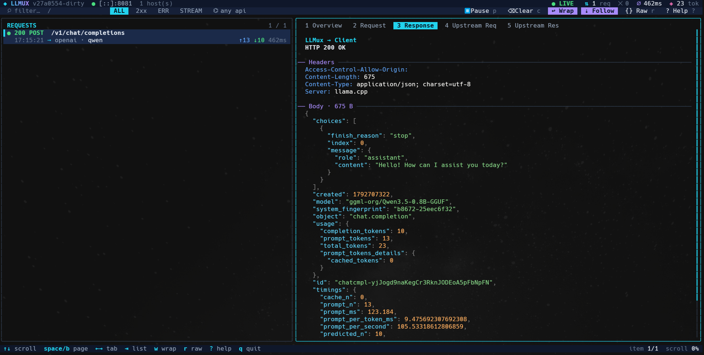

# ◆ LLMux

**LLMux** is a single-binary LLM gateway written in Go. It *emulates* the **OpenAI** and **Ollama**
APIs towards your clients and forwards the traffic to any OpenAI-compatible or Ollama server, with
**virtual-host** routing, API-key auth, header forwarding/overriding, model aliasing - and a sleek
**terminal UI** to inspect every request and response live.



```
 clients                         LLMux                              upstreams
┌────────────┐   OpenAI    ┌──────────────────┐   OpenAI      ┌──────────────────┐
│ SDKs, apps │ ──────────▶ │  vhost → dialect │ ────────────▶ │ OpenAI, vLLM,    │
│ Open WebUI │   Ollama    │  → auth → proxy  │   Ollama      │ LM Studio, Ollama │
│ Continue … │ ──────────▶ │  | translate     │ ────────────▶ │ …                │
└────────────┘             └────────┬─────────┘               └──────────────────┘
                                    │ records both legs
                              ┌─────▼─────┐
                              │  --tui    │
                              └───────────┘
```

* **Same dialect in and out** → transparent streaming reverse proxy (every path: chat, embeddings, images…).
* **Different dialect** → protocol translation through a neutral model (chat, streaming, model lists).

## Quick start

```bash
go mod tidy && make build          # -> bin/llmux

# 1. one-liner: expose a local Ollama as an OpenAI *and* Ollama API on :8080
./bin/llmux --upstream http://localhost:11434 --upstream-type ollama --tui

# 2. from a YAML file with virtual hosts
./bin/llmux --config configs/llmux.example.yaml --tui

# 3. protect it, alias models and inject headers
./bin/llmux --upstream https://api.openai.com --upstream-key "$OPENAI_API_KEY" \
            --api-key my-gateway-key --model-map gpt-4=gpt-4o-mini \
            --set-header "X-Team: research" --remove-header Cookie
```

```bash
curl localhost:8080/v1/chat/completions -H 'Authorization: Bearer my-gateway-key' \
     -H 'Content-Type: application/json' \
     -d '{"model":"gpt-4","messages":[{"role":"user","content":"Hello!"}],"stream":true}'

curl localhost:8080/api/chat -d '{"model":"gpt-4","messages":[{"role":"user","content":"Hello!"}]}'
```

## Command line

| Flag | Meaning |
|---|---|
| `-c, --config FILE` | YAML configuration |
| `-l, --listen ADDR` | listen address (`:8080`) |
| `--upstream URL` | upstream **server root**; creates a catch-all virtual host (`/v1` is added for you) |
| `--upstream-type T` | `openai` (default) or `ollama` |
| `--upstream-key KEY` | API key LLMux presents to the upstream |
| `--api-key KEY` | client key accepted by the gateway (repeatable) |
| `--host NAME` | DNS name for the CLI virtual host (repeatable, default `*`) |
| `--dialects a,b` | APIs exposed by the CLI host (default: all) |
| `--set-header "K: V"` | override/add an upstream request header (repeatable) |
| `--remove-header K` | drop an upstream request header (repeatable) |
| `--forward-header K` | forward *only* these client headers (repeatable, `X-*` patterns) |
| `--model-map a=b` | rewrite model names (repeatable) |
| `--tui` | interactive inspector |
| `--log-level L` | `debug`/`info`/`warn`/`error` |

Precedence: defaults < YAML < flags. See [`configs/llmux.example.yaml`](configs/llmux.example.yaml)
for every YAML option, including `${ENV}` / `${ENV:-default}` expansion.

## Virtual hosts

`hosts[].hosts` lists the DNS names a block answers to (`api.example.com`, `*.example.com`, `*`).
Resolution: exact name → longest wildcard → `*`. Each block has its own dialects, client keys,
upstream, model map and header rules. Test locally without DNS: `curl -H 'Host: openai.localhost' …`.

## Headers

Outbound request headers are computed as **forward → remove → set**, then the backend adds its own
credentials if you did not set them:

1. *forward*: with no `forward` list every client header passes except hop-by-hop ones, `Host`,
   `Content-Length`, `Accept-Encoding` and **client credentials** (`Authorization`, `x-api-key`,
   `api-key`, `Cookie`). With a list, only matching names (`X-Trace-*`) pass; listing `Authorization`
   explicitly forwards the client's own key (bring-your-own-key setups).
2. *remove*: delete names/patterns.
3. *set*: add/override; value supports `${ENV}`; an empty value deletes the header.

`headers.response` applies the same remove/set (and an allow-list) to what clients receive.

## Terminal UI (`--tui`)

```
 ◆ LLMUX v1.0  ● :8080  2 host(s)                    ● LIVE  ⇅ 128 req  ✕ 3  ⌀ 842ms  ◈ 12.4k tok
  ⌕ filter…  /   ALL  2xx  ERR  STREAM  ⌬ any api     ⏸ Pause p  ⌫ Clear c  ↩ Wrap  ⇣ Follow  {} Raw  ? Help
╭─ REQUESTS ───────────────────────╮╭─ 1 Overview  2 Request  3 Response  4 Upstream Req  5 Upstream Res ─╮
│▌● 200 POST  /v1/chat/completions ││  POST /v1/chat/completions                                          │
│   14:02:11 ⇄ openai · gpt-4o  ≈  ││  ● 200 OK   1.23s                                                   │
│ ● 401 GET   /v1/models           ││  Route   openai ⇄ ollama   (protocol translation)                   │
╰──────────────────────────────────╯╰─────────────────────────────────────────────────────────────────────╯
```

Left: live request list (newest first). Right: the selected exchange - overview with the assembled
**conversation**, the client request/response, and the **upstream** request/response (so you can see
exactly what translation produced). JSON is pretty-printed and syntax highlighted; SSE/NDJSON streams
are shown one event per line. Credentials in captured headers are masked (`inspector.redact`).
Control characters in payloads are stripped before display.

| Keys | Action |
|---|---|
| `↑ ↓` / `j k` | move selection (or scroll when the details pane is focused) |
| `Tab` / `Enter` | switch between list and details |
| `← →` / `h l` / `[ ]` / `1`–`5` | detail tabs |
| `PgUp PgDn`, `g G`, `J K`, `Space b` | paging / jumping / scrolling details |
| `/` | text filter (all words must match path, model, host, status…) |
| `s` · `d` · `Esc` | cycle status filter (ALL/2xx/ERR/STREAM) · cycle API · clear filters |
| `p` · `f` · `c` | pause · follow newest · clear history |
| `w` · `r` | wrap long lines · raw (unformatted) bodies |
| `?` · `q` | help · quit (stops the server) |

The mouse works too: click rows, tabs and toolbar buttons; scroll with the wheel. Use a dark,
true-colour terminal for the best look. Logs go to `server.log_file` (or nowhere) while the TUI runs.

## Architecture & SOLID

```
cmd/llmux            entrypoint (flags → config → app.Run)
internal/
  core/              neutral model + ALL abstractions (Dialect, Backend, StreamEncoder, …)
  wire/{openai,ollama}  wire formats + mapping to/from core (shared by dialect & backend)
  dialect/           client-facing API emulations   (registry + openai/, ollama/)
  backend/           upstream providers             (registry + openai/, ollama/)
  upstream/          tiny JSON HTTP client used by backends
  gateway/           pipeline: vhost → route → auth → proxy | translate; header policy
  inspector/         bounded recorder of both HTTP legs (nil-safe when disabled)
  tui/               Bubble Tea inspector
  config/            YAML + flags → Config
  app/               composition root
```

### Adding a new LLM API (e.g. Anthropic)

1. **Wire format** - `internal/wire/anthropic/types.go`: request/response structs plus `ToCore` /
   `FromCore…` mappers (Messages API: `system`, `messages`, `max_tokens`, `content[]` blocks, SSE events
   `content_block_delta` / `message_delta`).
2. **As an upstream** - `internal/backend/anthropic/backend.go` implementing `core.Backend`:

   ```go
   func (b *Backend) Dialect() string { return "anthropic" }
   func (b *Backend) PrepareHeaders(h http.Header) {
       if b.apiKey != "" && h.Get("x-api-key") == "" { h.Set("x-api-key", b.apiKey) }
       if h.Get("anthropic-version") == "" { h.Set("anthropic-version", "2023-06-01") }
   }
   // Chat → POST /v1/messages ; ChatStream → SSE → core.StreamChunk ; Models → GET /v1/models
   ```
   Register: `r.Register("anthropic", anthropic.Factory)` in `backend/registry.go`.
3. **As a client-facing API** - `internal/dialect/anthropic/dialect.go` implementing `core.Dialect`
   (`Match` → `POST /v1/messages`, encoders for JSON and SSE). Register it in `dialect/registry.go`.

## Behaviour notes & limits

* Translation covers **text chat** (+ streaming, usage, stop/temperature/top_p/max tokens) and **model
  listing**. Tool calls, images/multimodal parts, embeddings and `/api/generate` are not translated
  (they return `501`); in same-dialect (proxy) mode **everything** passes through untouched.
* `model_map` applies to both modes (rewrites the JSON `model` field in proxy mode).
* Upstream `timeout` is the time to *response headers*, so long streams are never cut off.
* Upstream URLs are server roots; a trailing `/v1` is trimmed automatically.

## Development

```bash
make test       # go vet + go test -race ./...
make build      # static binary in bin/
make docker     # container image
```

On Windows with MinGW use `Makefile.win` instead:

```bat
mingw32-make.exe -f Makefile.win           :: build -> bin\llmux.exe
mingw32-make.exe -f Makefile.win tui       :: build and start with the TUI
mingw32-make.exe -f Makefile.win help      :: list targets (test, test-fast, build-all, dist, ...)
```
